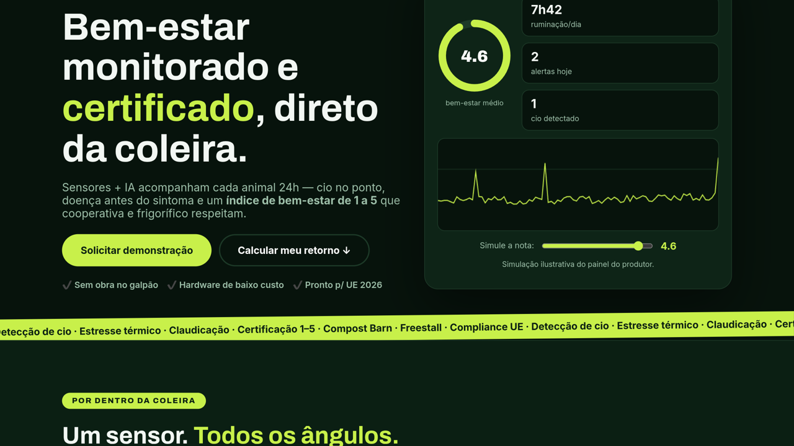
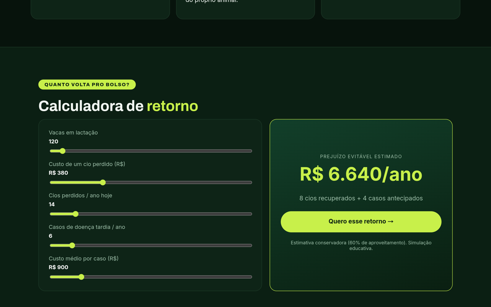
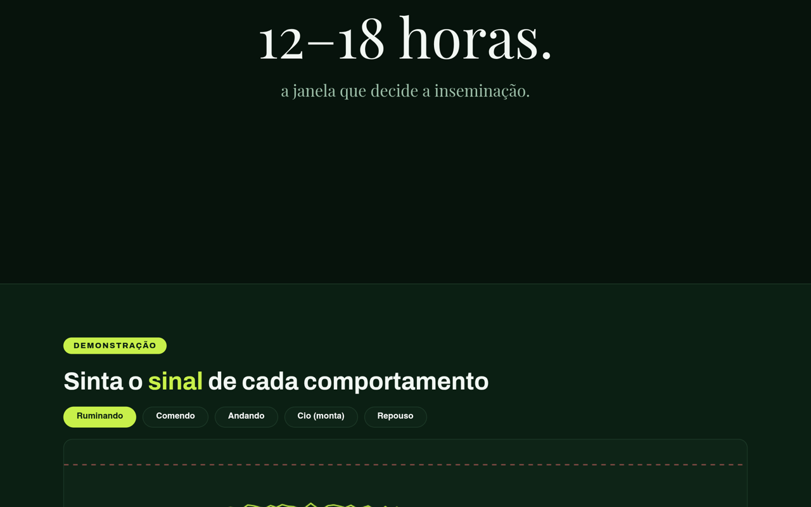
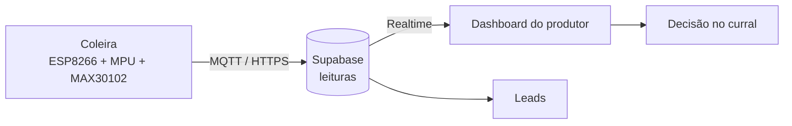

<div align="center">

### DataBov v2 — keynote em 3 atos

[](https://databov-v2.vercel.app)

*"O rebanho fala. o tempo todo."*

</div>

<a href="https://databov-v2.vercel.app"></a>

## Ato I — O problema

O agro perde dinheiro no invisível: cio perdido, doença que chega tarde, bem-estar sem prova. Caderneta não apita.

## Ato II — A solução

Sensores + IA acompanham cada animal 24h e viram um **índice de bem-estar de 1 a 5** — número que cooperativa e frigorífico respeitam.

## Ato III — Os números

| No palco | |
|---|---|
| 📊 Dashboard em tempo real | dial, ruminação, alertas, cio, gráfico + simulador (Supabase Realtime) |
| 🧮 Calculadora de ROI | sliders → R$/ano na hora |
| 🐄 Coleira 3D | Wemos + MPU6050 + MAX30102 em Three.js |
| 📝 Leads | formulário → Supabase + WhatsApp pronto |

## Cenas do espetáculo

**Ato III, cena 1 — a calculadora (R$ 6.640/ano na tela):**
<a href="https://databov-v2.vercel.app"></a>

**Ato III, cena 2 — o sinal de cada comportamento:**
<a href="https://databov-v2.vercel.app"></a>

## Roteiro técnico (como a mágica funciona)



## Bastidores

`index.html` (o palco) · `dashboard.html` (o painel) · `app.js` + `styles.css` (luz e som) · `js/collar3d.js` (o adereço) · `supabase-*` (o banco) · `api/health.js` (o ponto).

```bash
git clone https://github.com/Wagner-Schemmer/databov-v2.git
cd databov-v2 && python3 -m http.server
# dados reais: supabase-schema.sql no SQL Editor + supabase-config.js
```

WhatsApp comercial em `whatsapp_comercial`. Deploy: `vercel deploy --prod --yes`.

## Bilheteria (star history)

<a href="https://www.star-history.com/#Wagner-Schemmer/databov-v2&Date"></a>

## Elenco de apoio

Firmware da coleira: [`rebanho-vivo-backend`](https://github.com/Wagner-Schemmer/rebanho-vivo-backend) · Versão original: [`monitoramento-animal-site`](https://github.com/Wagner-Schemmer/monitoramento-animal-site)

---
Direção: [Wagner Schemmer](https://wagner-port.vercel.app) · [Portfólio](https://wagner-port.vercel.app)
