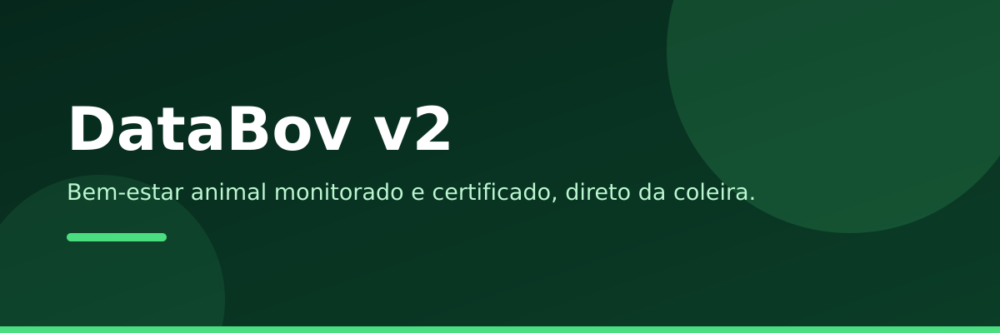

<div align="center">

[](https://github.com/Wagner-Schemmer/databov-v2/stargazers)
[](https://databov-v2.vercel.app)
[](https://databov-v2.vercel.app/dashboard.html)


  <a href="https://databov-v2.vercel.app"></a>

  <h1>DataBov v2</h1>

  <p>
    <b>Bem-estar animal monitorado e certificado, direto da coleira.</b>
    <br />
    Landing + dashboard em tempo real + calculadora de ROI + coleira 3D interativa.
  </p>

  <p>
    <a href="https://databov-v2.vercel.app"><b>Demo</b></a> ·
    <a href="https://databov-v2.vercel.app/dashboard.html">Dashboard</a> ·
    <a href="#o-que-cada-parte-faz">Partes</a> ·
    <a href="#como-rodar">Como rodar</a> ·
    <a href="#stack">Stack</a>
  </p>
</div>

<a href="https://databov-v2.vercel.app"></a>

Site do sistema DataBov: sensores + IA acompanham cada animal 24h — cio no ponto, doença antes do sintoma — e viram um índice de bem-estar de 1 a 5. Aqui moram a landing de vendas, o painel do produtor e a captura de leads.

## O que cada parte faz

| Parte | O que faz | Dados |
|---|---|---|
| **Dashboard ao vivo** | Dial de bem-estar, ruminação, alertas, cio detectado, gráfico + simulador de nota | ✓ Supabase Realtime (`leituras`) |
| **Calculadora de ROI** | Sliders de rebanho/cio/doença com retorno em R$/ano | ✓ cálculo local |
| **Coleira 3D** | Wemos D1 Mini + MPU6050 + MAX30102 em Three.js, passo a passo | — |
| **Captura de leads** | Formulário → tabela `leads` + WhatsApp com mensagem pronta | ✓ Supabase |
| **Busca + navegação** | Navbar glassy com busca de seções, menu mobile, topo `#inicio` | — |

## Como rodar

1. `python3 -m http.server` na pasta e abra o `index.html`.
2. Para dados reais: rode `supabase-schema.sql` no SQL Editor e preencha `supabase-config.js`.
3. Deploy: `vercel deploy --prod --yes` (sem `--name`, para não duplicar o projeto).

## Estrutura

```
databov-v2/
├── index.html          # landing (cine, hero, coleira 3D, solução, ROI, certificação, planos, demo, FAQ)
├── dashboard.html      # painel do produtor em tempo real
├── styles.css / app.js # identidade verde + interatividade
├── js/collar3d.js      # coleira 3D (three@0.160.0)
├── supabase-*.js/sql   # config + schema (depoimentos, leituras, leads, site_config)
└── api/health.js       # health check p/ monitoramento
```

## Personalizar

1. WhatsApp comercial em `supabase-schema.sql` (`whatsapp_comercial`) ou `site_config`.
2. Textos, preços e ROI padrão em `index.html` / `app.js`.
3. Chaves do Supabase em `supabase-config.js`.

## Stack

HTML · CSS · JavaScript · Three.js · Supabase (Realtime + Auth). Deploy na Vercel.

## Ecossistema

- Firmware da coleira (ESP8266 → Supabase): [`rebanho-vivo-backend`](https://github.com/Wagner-Schemmer/rebanho-vivo-backend)
- Site v1: [`monitoramento-animal-site`](https://github.com/Wagner-Schemmer/monitoramento-animal-site) ([databov.vercel.app](https://databov.vercel.app))

## Quem faz

<a href="https://github.com/Wagner-Schemmer/databov-v2/graphs/contributors"></a>

## Star history

<a href="https://www.star-history.com/#Wagner-Schemmer/databov-v2&Date"></a>

---
Feito por [Wagner Schemmer](https://wagner-port.vercel.app) · [Portfólio](https://wagner-port.vercel.app) · [LinkedIn](https://www.linkedin.com/in/wagner-schemmer-martins-46950627a)
